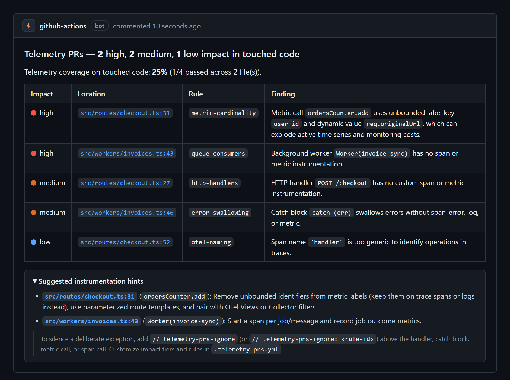

<p align="center">
  
</p>

# Telemetry PRs

Catch missing OpenTelemetry spans, metrics, logs, and high-cardinality metric labels in TypeScript/Node.js pull requests — **fast, static, vendor-neutral, and 100% inside your CI**.

Auto-instrumentation covers HTTP and database calls, not the business logic, background jobs, queue consumers, silent catch blocks, and unbounded metric labels that cause blind outages and billing spikes. Telemetry PRs runs on every PR diff, reports touched-code telemetry coverage, and groups gaps by **impact tier** (`high`, `medium`, `low`) before they merge.

Available on **[GitHub Marketplace](https://github.com/marketplace/actions/telemetry-prs)**.

<p align="center">
  
</p>

## Why CI-native & static?

- **Your code never leaves your CI runner.** No SaaS upload, no LLM API keys, no external network calls.
- **Vendor-neutral.** Works with OpenTelemetry going to Datadog, Grafana, Honeycomb, Dash0, Jaeger, or anything else.
- **Quiet by default.** Only checks code units touched by the PR diff, skips trivial 1–3 line delegators and frontend `'use client'` files, updates a single PR comment in place with clickable file links, stays silent on clean PRs, defaults inline diff annotations to `false`, and supports inline `// telemetry-prs-ignore` directives.
- **Repo-aware.** Detects when no observability or structured logging SDK is configured in `package.json` or `wrangler.toml`.

## Quickstart (GitHub Action)

Add `.github/workflows/telemetry-prs.yml`:

```yaml
name: Telemetry Check
on:
  pull_request:

permissions:
  contents: read
  pull-requests: write

jobs:
  telemetry-prs:
    runs-on: ubuntu-latest
    steps:
      - uses: actions/checkout@v7
      - uses: telemetry-prs/telemetry-prs@v0
        with:
          github-token: ${{ secrets.GITHUB_TOKEN }}
```

Works zero-config out of the box. Or generate a tailored `.telemetry-prs.yml` (auto-detecting `pino`, `winston`, `prom-client`, `@opentelemetry/api`, `dd-trace`, and source folders):

```bash
node dist/cli.cjs init --workflow
```

### Action Inputs & Outputs

| Input | Default | Description |
| :--- | :--- | :--- |
| `config` | `.telemetry-prs.yml` | Path to configuration file |
| `block-on` | `none` | Minimum impact tier that fails CI: `none` (comment only), `high`, `medium`, or `low` |
| `mode` | `""` | Legacy alias for `block-on` (`fail` maps to `high`, `comment` maps to `none`) |
| `github-token` | `${{ github.token }}` | Token for reading PR diffs and updating the PR comment |
| `comment-on-pr` | `true` | Post/update a single summary comment on the PR |
| `annotate` | `false` | Emit inline file/line annotations on changed lines (opt-in to keep diffs quiet) |
| `sarif-file` | `""` | Optional path to write SARIF 2.1.0 output for GitHub Code Scanning |

Outputs: `findings-count`, `high-impact-count`, `medium-impact-count`, `low-impact-count`, `coverage-percent`.

## Impact Tiers & Built-in Rules

Monitoring gaps are ranked by operational impact rather than compiler `warning`/`error` levels:

| Impact | Meaning | Default Rules |
| :--- | :--- | :--- |
| 🔴 **`high`** | Direct blind-spot outage or TSDB/billing cardinality explosion | `metric-cardinality`, `queue-consumers`, high-cardinality `otel-naming` |
| 🟠 **`medium`** | Silent failure or missing business-level context (auto-instrumentation may still exist) | `error-swallowing`, `http-handlers` |
| 🔵 **`low`** | Trace readability and query hygiene | generic or empty `otel-naming` |

| Rule | Default Impact | What it checks |
| :--- | :--- | :--- |
| `metric-cardinality` | `high` | Unbounded attribute/label keys (`userId`, `requestId`, `email`, `ip`, `orderId`, `traceId`, `sessionId`, `uuid`, `token`, `url`, etc.) and dynamic value expressions (`req.url`, `req.originalUrl`, `err.message`, `Date.now()`, `randomUUID()`) passed to OpenTelemetry `.add()`/`.record()` or `prom-client` `labelNames`/`.inc()`/`.observe()`/`.set()`/`.labels()` |
| `queue-consumers` | `high` | BullMQ `Worker`, Bull `queue.process`, Agenda `agenda.define`, KafkaJS `eachMessage`/`eachBatch`, RabbitMQ `channel.consume`, SQS consumers, cron jobs, Inngest, AWS Lambda queue/event handlers, Cloudflare Workers `queue`/`scheduled`, and `workers/` functions |
| `error-swallowing` | `medium` | `catch` blocks that do not rethrow or forward errors (`next(e)`, `done(e)`, `emit('error', ...)`) and emit no `recordException`, structured error log, or error metric (benign parse/probe fallbacks like `JSON.parse` are skipped) |
| `http-handlers` | `medium` | Express, Fastify, Hapi, Hono, Koa, NestJS, Next.js App Router, Next.js Pages API, Next.js `'use server'` actions, tRPC procedures, AWS Lambda HTTP handlers, Cloudflare Workers `fetch`, Cloudflare Pages `onRequest*` functions, and GraphQL `Query`/`Mutation` resolvers missing a custom span or business metric |
| `otel-naming` | `high` / `low` | `startActiveSpan` / `startSpan` calls with high-cardinality dynamic names (`` `user-${id}` ``, `'order-' + id`, **high impact**) or empty/generic names (`'handler'`, `'fn'`, `'span'`, **low impact**) |

### Cardinality & Defense in Depth

Static PR checks catch obvious unbounded metric labels and dynamic span names before merge, when they're cheapest to fix. Dynamic enum growth (e.g., an innocent-looking `tenant` label that grows unbounded at runtime) requires runtime and rule-layer guardrails too — pair Telemetry PRs with:

- **Schema registries:** [OpenTelemetry Weaver](https://github.com/open-telemetry/weaver) for formal semantic-convention registries and live OTLP checks.
- **PromQL & alert rules:** [Cloudflare `pint`](https://github.com/cloudflare/pint) or [Prometheus `promtool`](https://prometheus.io/docs/prometheus/latest/command-line/promtool) for linting alerting and recording rules.
- **Runtime caps:** [OpenTelemetry SDK Views](https://opentelemetry.io/docs/specs/otel/metrics/sdk/) (plus the default 2,000-series cardinality limit), OTel Collector `transform`/`filter` processors, and Prometheus `sample_limit`/`label_limit`.

### Silencing deliberate exceptions

```ts
// telemetry-prs-ignore
router.post('/internal/noop', async (req, res) => { ... });

// telemetry-prs-ignore: metric-cardinality
// telemetry-prs-ignore: error-swallowing
// telemetry-prs-ignore: otel-naming
```

## Local CLI

```bash
node dist/cli.cjs init --workflow
node dist/cli.cjs check --base origin/main
node dist/cli.cjs check --base origin/main --block-on high
node dist/cli.cjs scan ./src
node dist/cli.cjs scan ./examples --format markdown
node dist/cli.cjs scan ./examples --format sarif
```

## Development

```bash
npm install
npm run typecheck
npm test
npm run build
```

## License

MIT
